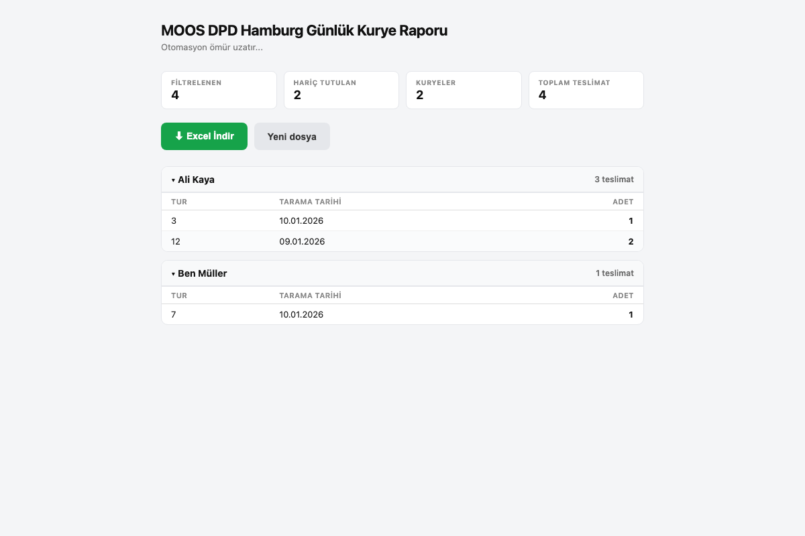

# DPD Courier Report Tool

[](https://github.com/simple85/the-moos-hamburg-dpd-excel-tool/actions/workflows/ci.yml)


A browser-based tool that turns the daily DPD delivery export of a Hamburg courier subcontractor into a per-courier delivery report, automating what was otherwise done by hand in Excel.

**Live tool:** [simple85.github.io/the-moos-hamburg-dpd-excel-tool](https://simple85.github.io/the-moos-hamburg-dpd-excel-tool/)

<p align="center">
  
</p>

## What It Does

1. Drop the daily `THE_MOOS_*.xlsx` export onto the page.
2. The tool keeps only successful deliveries (`DELIVERED`, `DELIVERED_TO_PUDO`, `DELIVERY`).
3. Parcels are grouped by **courier → tour → scan date**, with totals per courier.
4. Download the result as a two-sheet Excel file: a daily summary (*Özet*) and per-tour totals (*Tur Toplamları*).

Everything runs in the browser. **No data leaves the computer**: there's no server and no upload, which matters for files containing customer delivery data.

## Tech Stack

| Area | Tools |
|------|-------|
| App | Vanilla JavaScript, HTML, CSS (single page, no build step) |
| Excel | SheetJS (`xlsx`) for reading and writing workbooks |
| Testing | Jest (report logic), Playwright (real file uploads on Chrome and iPhone Safari), html-validate |
| Hosting | GitHub Pages |

## Project Structure

```text
index.html          # UI: upload, results, download
report.js           # pure report logic: date parsing, filtering, grouping, export rows
__tests__/          # Jest unit tests for report.js
e2e/                # Playwright tests + sample .xlsx fixtures
```

`report.js` has no DOM code, so the business rules are unit-tested directly. It loads as a plain `<script>` in the browser and as a CommonJS module in Jest. Courier names from the uploaded file are HTML-escaped before rendering.

## Running Locally

Open `index.html` in a browser, or serve the folder:

```bash
npm install
npx serve .
```

## Testing

```bash
npm test            # unit tests (Jest)
npm run test:e2e    # end-to-end tests (Playwright)
npm run lint:html   # HTML validation
```

| Layer | What it covers |
|-------|----------------|
| Unit | Excel serial date conversion, status filtering, grouping and numeric tour sorting, unknown couriers, export rows, HTML escaping |
| End-to-end | Uploading a real `.xlsx`, stats and per-courier totals, collapsing couriers, Excel download, missing-column errors, reset, no broken assets, mobile layout |

Run `npx playwright install` once before the first E2E run.

## License

Built for a private client. All rights reserved; see [LICENSE](LICENSE).
